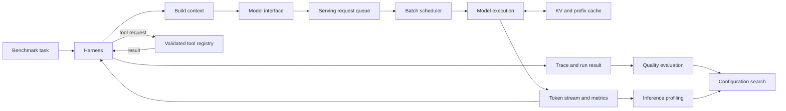

# Architecture

Optimo separates agent behavior from model serving so each can be changed and measured independently.

## Layer 1: Agent harness

A harness is the explicit application control loop around a model. It owns task intake, context construction, model calls, interpretation of structured output, tool selection and execution, state/history updates, retry and recovery decisions, stopping conditions, trace generation, and the final answer.

The model proposes an action; it does not execute tools, own durable state, decide whether an exception is retryable, or enforce limits. Those are application responsibilities because they must be inspectable and testable.

The request flow is:

`task -> build context -> model call -> parse output -> optional tool selection -> execute tool -> update state/history -> retry/recover if needed -> termination -> final answer`

`HarnessState` is an append-only trajectory plus counters and status. Tools are exposed as name, description, JSON-like argument schema, validation, and execution. Retries should classify a failure before consuming a retry budget. Stopping conditions include successful final output, max steps, retry exhaustion, repeated-action/loop policy, and non-retryable failure. Every consequential transition produces a typed trace event; evaluation derives separate metrics from the completed trajectory instead of hiding them in one score.

Three architectures share the `Harness` protocol:

1. **Simple Tool Loop** — model, optional tool, model, finish.
2. **Planner / Executor** — planner creates typed steps, executor acts, evaluator decides completion or replanning.
3. **Stateful Retry Harness** — explicit state plus retry/fallback and loop-detection policies.

## Layer 2: Inference serving

The inference layer accepts a `ModelRequest` and returns a `ModelResponse`; it does not know task success, tool correctness, or harness termination. Its flow is:

`model request -> request queue -> batching/scheduling -> model execution -> KV cache -> token generation -> streamed response -> performance metrics`

- **Batching** combines compatible requests; **continuous batching** admits and removes sequences as they progress rather than waiting for a whole static batch.
- **KV cache** stores attention keys/values from already processed tokens, avoiding recomputation during autoregressive generation. **Prefix caching** can reuse those states between requests sharing an identical prefix.
- **Quantization** uses lower-precision weights and sometimes activations/cache. It can reduce memory and raise throughput, but may change quality or add kernel overhead.
- Longer contexts consume more cache memory and prefill time. More concurrency can raise throughput while worsening queueing and tail latency.
- Backends differ in schedulers, cache management, quantization support, metrics, and API details. The `ServingBackend` boundary keeps harness behavior independent of vLLM or a future SGLang adapter.

The deterministic mock verifies application correctness only. The vLLM adapter talks to an OpenAI-compatible local server. Neither this repository nor the harness reimplements tokenizers, attention, CUDA kernels, or inference engines.

## Data and module boundaries

- `harnesses/`: contracts, state, and harness implementations.
- `tools/`: tool contracts, validation, registry, deterministic implementations.
- `benchmarks/`: task definitions and deterministic workload fixtures.
- `serving/`: model and serving-backend contracts plus adapters.
- `tracing/`: trajectory event schema and recorder seam.
- `evaluation/`: quality metrics and failure taxonomy scaffolds.
- `profiling/`: request/performance measurement scaffolds.
- `optimization/`: experiment configurations and search/Pareto scaffolds.
- `backend/`: HTTP API and later SQLAlchemy persistence.
- `frontend/`: thin operator UI; no harness decisions belong here.

## Persistence and trust boundaries

PostgreSQL will store run metadata, configuration snapshots, aggregate metrics, and trace events. Raw prompts/tool outputs can contain secrets or personal data, so production tracing requires redaction and configurable retention. Tool inputs are always validated; a model-generated tool request is untrusted input.

## First-pass non-goals

No Kubernetes, distributed orchestration, custom inference engine, automatic optimizer library, production auth, or claim that mock metrics represent GPU performance. Streaming, migrations, and durable run storage are later milestones.

## AI Systems Research Lab extension

The domain-independent Lab architecture, including ExperimentRunner, adapters, Research Brain, and the human-directed Build Agent/Build Loop, is documented in `docs/ARCHITECTURE.md` and `docs/BUILD_LOOP.md`. The build loop reuses the existing harness and evaluation layers; it does not replace or duplicate them.
